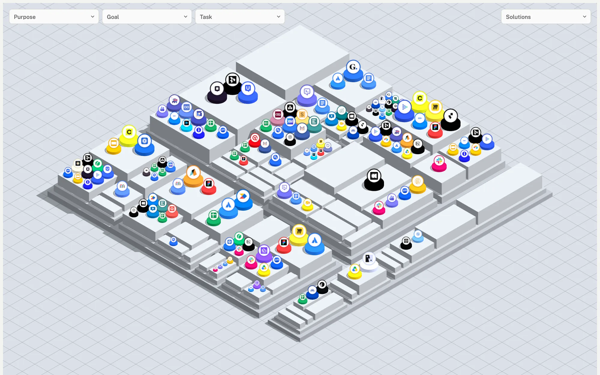
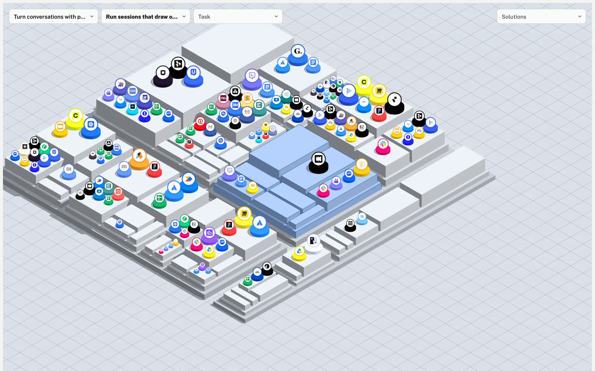
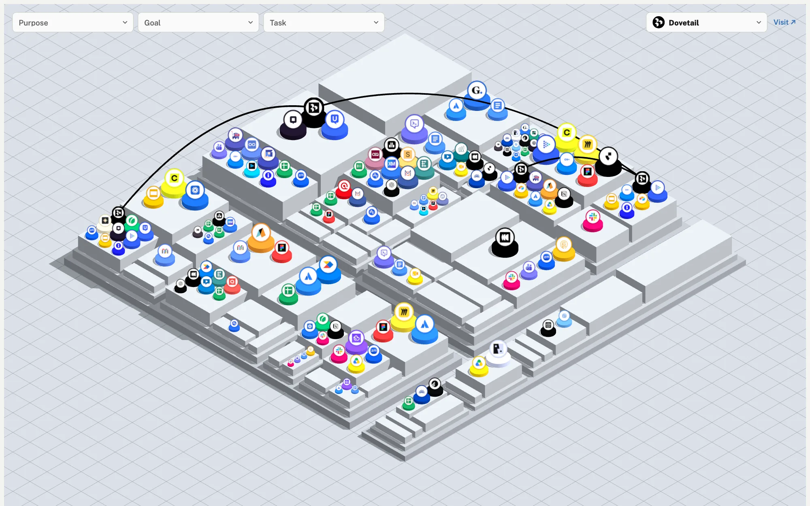
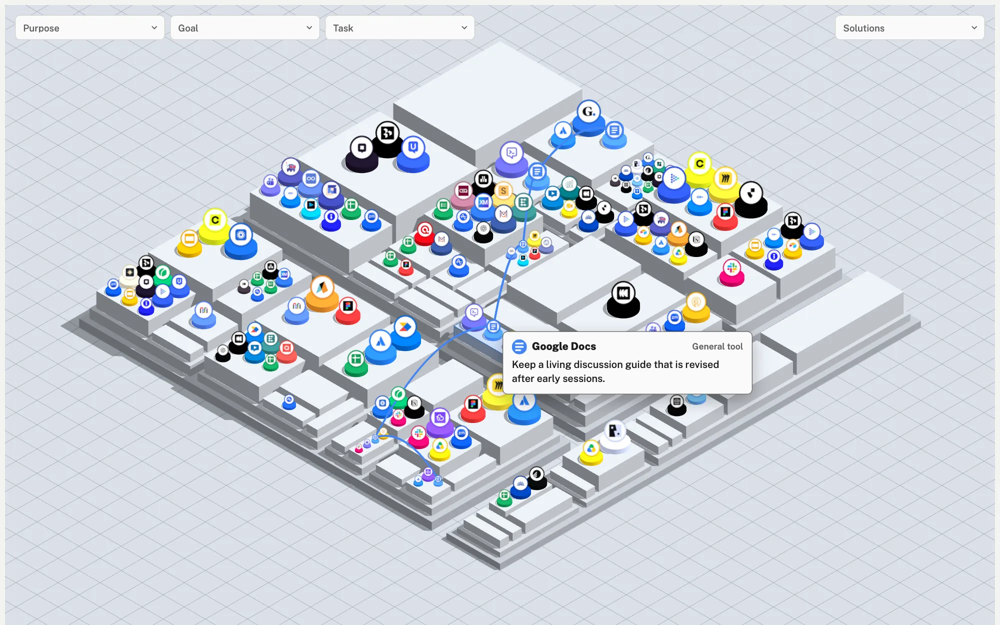

# Problem Space Map

One picture of where people's needs go unmet and which products already serve them.

**Live maps:** [UX research](https://miguel.design/problem-space-map/) and [trading card game players](https://miguel.design/problem-space-map/tcg/)



Tall, wide blocks with few logos are needs that many people have and few products meet. Use the map to decide
where to build or research next, from what people said rather than from feature opinions.

This repository is a template. One data file, `map.json`, describes a map; the page (Vite and three.js) draws it.

## How to read it

| What you see | What it means |
|---|---|
| **Block** | Something people are trying to do. Three levels stack: purpose › goal › task. Lower layers are darker. |
| **Footprint** | How many people raised it. A task's footprint is its people; a goal's or purpose's is the sum of its tasks. |
| **Height** | Unmet opportunity: importance + max(importance − satisfaction, 0). |
| **Logos** | Products and tools people use for that task. Specialist products are full size; general tools (spreadsheets, chat, video calls) are smaller. Logos are the only colour. |
| **Arcs** | Join every task one solution serves, in its colour. |

Height in detail (`src/model.js`):

- importance = 1 + 9 · rr^0.6, where rr = people ÷ the busiest section at the same level.
- Satisfaction is 0–10 per task (default 5). A goal or purpose uses its children's people-weighted mean.
- Tasks stand at full opportunity. Goals and purposes are drawn at 0.3× and 0.22× of theirs, each stacked on its parent.

What to look for:

- **Tall, wide, few logos:** many people, low satisfaction, little help today.
- **Crowded with logos:** the market already competes there.

## Using it

- **Dropdowns** (top left): pick a purpose, goal or task. The view moves there and the block glows. "Any …" steps back up.
- **Solutions** (top right): pin a product or tool to see its arcs. Each has a "Visit ↗" link to its site.
- **Hover** a block: its full name, parent trail and people count. Hover a logo: what people do with it on that task.
- **Click** a block to select it, a logo to pin it (click again to unpin), the background to clear both.
- **Drag** to pan, **scroll** to zoom. One fixed isometric angle. **F** for full screen.

| A goal chosen from the Goal dropdown | Dovetail pinned: arcs join the four tasks it serves |
|---|---|
|  |  |



## Try it

```sh
npm install
npm run dev                                         # UX research map, http://localhost:5173/problem-space-map/
MAP=examples/tcg-players/map.json npm run dev       # TCG players map
```

To make a map for your own domain, follow [AGENTS.md](AGENTS.md). It covers inputs, commands, the schema and
publishing, and how to get data without a full study.

## Examples

Open the live map first; the "about" link explains how each was made.

| Example | Scope | Caveat |
|---|---|---|
| [UX research](https://miguel.design/problem-space-map/) ([about](examples/ux-research/README.md)) | 60 tasks, 11 goals, 3 purposes; 60 solutions (38 products, 22 tools) | Hierarchy and counts are from practitioner interviews. Satisfaction is authored and illustrative, not measured. |
| [Trading card game players](https://miguel.design/problem-space-map/tcg/) ([about](examples/tcg-players/README.md)) | 57 tasks, 16 goals, 5 purposes; 14 solutions | Hierarchy from the [purpose-graphing](https://github.com/miguel-perez/purpose-graphing) skill. Satisfaction scored from each participant's statements by an AI-assisted analysis pipeline. 10 people, mostly podcast hosts. |

### Products on the UX map

Generated from the example maps by `npm run docs:products`.

<!-- products:start -->
| Solution | Kind | Tasks it serves |
|---|---|---|
| [Dovetail](https://dovetail.com) | Product | 4 tasks |
| [Tetra Insights](https://tetrainsights.com/) | Product | 4 tasks |
| [dscout](https://dscout.com/) | Product | 3 tasks |
| [Miro](https://miro.com) | Product | 3 tasks |
| [Optimal Workshop](https://www.optimalworkshop.com/) | Product | 3 tasks |
| [Prolific](https://www.prolific.com/) | Product | 3 tasks |
| [Aurelius](https://aureliuslab.com) | Product | 2 tasks |
| [BuildBetter](https://buildbetter.ai) | Product | 2 tasks |
| [Condens](https://condens.io) | Product | 2 tasks |
| [Enterpret](https://enterpret.com) | Product | 2 tasks |
| [Ethnio](https://ethn.io/) | Product | 2 tasks |
| [Grain](https://grain.com) | Product | 2 tasks |
| [Great Question](https://greatquestion.co) | Product | 2 tasks |
| [Jira Product Discovery](https://atlassian.com) | Product | 2 tasks |
| [Listen Labs](https://listenlabs.ai) | Product | 2 tasks |
| [Lookback](https://lookback.com) | Product | 2 tasks |
| [Loom](https://loom.com) | Product | 2 tasks |
| [Marvin](https://heymarvin.com) | Product | 2 tasks |
| [MAXQDA](https://www.maxqda.com/) | Product | 2 tasks |
| [Maze](https://maze.co) | Product | 2 tasks |
| [Notion](https://notion.so) | Product | 2 tasks |
| [Outset](https://outset.ai) | Product | 2 tasks |
| [Productboard](https://productboard.com) | Product | 2 tasks |
| [Qualtrics](https://www.qualtrics.com/) | Product | 2 tasks |
| [Rally UXR](https://rallyuxr.com/) | Product | 2 tasks |
| [Userlytics](https://www.userlytics.com/) | Product | 2 tasks |
| [UserTesting](https://usertesting.com) | Product | 2 tasks |
| [ATLAS.ti](https://atlasti.com) | Product | 1 task |
| [Hotjar](https://hotjar.com) | Product | 1 task |
| [Looppanel](https://looppanel.com) | Product | 1 task |
| [Lyssna](https://lyssna.com) | Product | 1 task |
| [Notably](https://notably.ai) | Product | 1 task |
| [Reduct](https://reduct.video) | Product | 1 task |
| [Respondent](https://respondent.io) | Product | 1 task |
| [Sprig](https://sprig.com) | Product | 1 task |
| [Strella](https://strella.io) | Product | 1 task |
| [Unwrap](https://unwrap.ai) | Product | 1 task |
| [User Interviews](https://userinterviews.com) | Product | 1 task |
| [Google Sheets](https://sheets.google.com) | General tool | 7 tasks |
| [Google Docs](https://docs.google.com) | General tool | 6 tasks |
| [FigJam](https://figma.com) | General tool | 5 tasks |
| [Slack](https://slack.com) | General tool | 5 tasks |
| [Amplitude](https://amplitude.com) | General tool | 4 tasks |
| [Zoom](https://zoom.us) | General tool | 4 tasks |
| [Confluence](https://confluence.atlassian.com) | General tool | 3 tasks |
| [Google Drive](https://drive.google.com) | General tool | 3 tasks |
| [Google Forms](https://forms.google.com) | General tool | 3 tasks |
| [Google Slides](https://slides.google.com) | General tool | 3 tasks |
| [Microsoft Teams](https://teams.microsoft.com) | General tool | 3 tasks |
| [Mural](https://mural.co) | General tool | 3 tasks |
| [Otter.ai](https://otter.ai) | General tool | 3 tasks |
| [tl;dv](https://tldv.io/) | General tool | 3 tasks |
| [Airtable](https://airtable.com) | General tool | 2 tasks |
| [Calendly](https://calendly.com) | General tool | 2 tasks |
| [ChatGPT](https://chatgpt.com) | General tool | 2 tasks |
| [Fathom](https://www.fathom.ai/) | General tool | 2 tasks |
| [Google Meet](https://meet.google.com) | General tool | 2 tasks |
| [Intercom](https://intercom.com) | General tool | 2 tasks |
| [Typeform](https://typeform.com) | General tool | 2 tasks |
| [Tremendous](https://www.tremendous.com/) | General tool | 1 task |
<!-- products:end -->

## Prior art

- Jim Kalbach, [Combining Mental Model Diagrams and Jobs To Be Done](https://experiencinginformation.com/2016/12/11/combining-mental-model-diagrams-and-jobs-to-be-done/)
  (2016): what people are trying to do, lined up with the products that support them. This map was inspired by it.
- Indi Young's mental model diagrams: towers of people's thinking with an organisation's support aligned
  underneath. Here the towers are blocks and the support is the logos. The [purpose-graphing](https://github.com/miguel-perez/purpose-graphing) skill
  (`npx skills add miguel-perez/purpose-graphing`), which writes the `groups.csv` this repo converts, was
  developed from data Indi Young shared with the author.
- Tony Ulwick's Outcome-Driven Innovation opportunity score, importance + max(importance − satisfaction, 0),
  sets each block's height.

## License

Code: [MIT](LICENSE). Example data (`examples/*/map.json`, `examples/tcg-players/solutions.json`,
`tests/fixtures/`): [CC BY 4.0](https://creativecommons.org/licenses/by/4.0/). Product names and logos belong
to their owners and are shown to identify the products.
